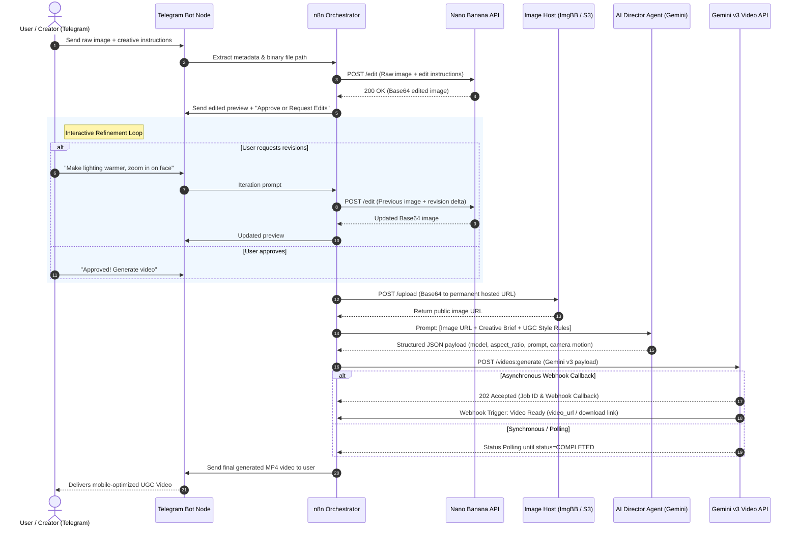

# 🎬 UGC Video Creation Pipeline with Gemini & n8n

[](https://n8n.io/)
[](https://ai.google.dev/)
[](https://core.telegram.org/bots/api)
[](https://nanobanana.com/)
[](https://opensource.org/licenses/MIT)

An end-to-end autonomous UGC (User-Generated Content) video generation pipeline built with **n8n**, **Telegram**, **Nano Banana API**, and **Google Gemini Video (v3)**. 

This system integrates an interactive human-in-the-loop image refinement feedback loop, automatic cloud asset hosting, and an **AI UGC Video Director Agent** that transforms raw visual assets and conversational feedback into broadcast-ready, mobile-first (`9:16`) short-form video ads.

---

## 📌 Table of Contents

- [Overview](#-overview)
- [Architecture & System Flow](#-architecture--system-flow)
- [Key Features](#-key-features)
- [Workflow Pipeline Breakdown](#-workflow-pipeline-breakdown)
  - [1. Telegram Ingestion & Session Handling](#1-telegram-ingestion--session-handling)
  - [2. Nano Banana Image Editing & Interactive Feedback Loop](#2-nano-banana-image-editing--interactive-feedback-loop)
  - [3. Asset Hosting & URL Conversion](#3-asset-hosting--url-conversion)
  - [4. AI Video Director Agent](#4-ai-video-director-agent)
  - [5. Gemini v3 Video Generation Engine](#5-gemini-v3-video-generation-engine)
  - [6. Result Delivery & Telegram Dispatch](#6-result-delivery--telegram-dispatch)
- [AI Director Agent Prompt & JSON Schema](#-ai-director-agent-prompt--json-schema)
- [Prerequisites & Environment Configuration](#-prerequisites--environment-configuration)
- [Setup & Deployment Guide](#-setup--deployment-guide)
- [Engineering Best Practices & Gotchas](#-engineering-best-practices--gotchas)
- [Example Scenario: Cowboy Lifestyle UGC Ad](#-example-scenario-cowboy-lifestyle-ugc-ad)
- [Troubleshooting & FAQs](#-troubleshooting--faqs)
- [Roadmap & Enhancements](#-roadmap--enhancements)
- [License](#-license)

---

## 🚀 Overview

Creating high-performing UGC video ads traditionally requires coordinating designers, prompt engineers, and video editors. This pipeline automates the entire lifecycle through a single messaging interface:

1. **Telegram Trigger**: A creator or client uploads a reference image or selfie along with a creative concept.
2. **AI Image Polish & Revision Loop**: The image is routed to **Nano Banana** for targeted AI image transformations. The system returns the edit to Telegram, allowing the user to request tweaks or approve the asset.
3. **Direct URL Resolution**: Once approved, the binary/Base64 image is uploaded to a high-speed hosting provider (e.g., ImgBB / S3) to produce a secure, publicly accessible CDN URL.
4. **AI Director Synthesis**: An autonomous LLM agent acts as a UGC Video Director, analyzing the image semantics and creative brief to synthesize precise cinematic instructions.
5. **Gemini v3 Video Synthesis**: Google Gemini's advanced video model generates an ultra-realistic 8-second vertical (`9:16`) video.
6. **Delivery**: The synthesized video is returned directly to Telegram for immediate publication or ad distribution.

---

## 🏗 Architecture & System Flow



---

## ✨ Key Features

- **📱 Mobile-First Native UGC**: Tailored for TikTok, Instagram Reels, and YouTube Shorts with native `9:16` vertical aspect ratio.
- **🔄 Interactive Human-in-the-Loop (HITL)**: Users can guide image generation and retouching iteratively through Telegram before expending video generation credits.
- **🧠 Director-Grade AI Agent**: An intelligent agent translates conversational, loose user prompts into hyper-detailed camera movements, lighting instructions, and temporal action prompts.
- **⚡ Lightweight Data Pipelines**: Eliminates n8n execution bloat by converting in-memory binary blobs and Base64 strings to CDN-hosted URLs immediately before video synthesis.
- **🛡 Enterprise Resilience**: Built-in fallback parameters, asynchronous callback webhooks, and rate-limit guardrails.

---

## ⚙️ Workflow Pipeline Breakdown

### 1. Telegram Ingestion & Session Handling
- **Trigger**: Telegram Trigger Node listening for incoming photos and text messages (`/start`, `/edit`, or photo uploads).
- **Metadata Extraction**: Extracts `file_id`, `chat_id`, `user_id`, caption, and timestamps.
- **File Retrieval**: Leverages Telegram's `getFile` endpoint to download the raw binary asset into n8n's transient execution storage.

### 2. Nano Banana Image Editing & Interactive Feedback Loop
- **Official API Integration**: Sends the raw image binary to the official Nano Banana endpoint for stylized modifications, character consistency, or aesthetic corrections.
- **Payload Parsing**: Nano Banana returns the modified asset as a Base64-encoded string.
- **Conversion Utility**: A dedicated n8n Function / Code node converts the Base64 stream into a standard binary file object.
- **Telegram Interactive Prompt**: Dispatches the revised image back to the Telegram chat with inline keyboard buttons (`✅ Approve & Render Video`, `✏️ Request Further Edits`).
- **Loop Controller**: Evaluates user response state; routes back to Nano Banana on edit requests, or advances to CDN upload upon approval.

### 3. Asset Hosting & URL Conversion
- **Why It Matters**: Downstream video generation models (like Gemini v3) require accessible HTTP/HTTPS URLs rather than megabytes of inline Base64 data. Storing raw Base64 in n8n execution history also degrades database performance.
- **Hosting Node**: Employs an HTTP Request node targeting an external media API (e.g., ImgBB, Cloudinary, AWS S3, or Google Cloud Storage).
- **Output**: Returns an immutable, public asset URL (e.g., `https://i.ibb.co/xyz/final-frame.png`).

### 4. AI Video Director Agent
- **Role**: Functions as a virtual UGC Creative Director.
- **Input Context**: Takes the reference image description, user creative prompt, target duration (8 seconds), and formatting constraints.
- **Processing**: Synthesizes prompt text incorporating realistic human micro-expressions, dynamic camera movements (e.g., handheld jitter, subtle pan, push-in), and natural ambient lighting.
- **Output**: Enforces strict JSON adherence without markdown fluff, preventing downstream parsing failures.

### 5. Gemini v3 Video Generation Engine
- **Model**: Google Gemini Video v3 (`veo-3` / `gemini-video-v3`).
- **Input Parameters**:
  - `prompt`: Expanded cinematic instruction from the Director Agent.
  - `image_url`: Approved reference image from the CDN.
  - `aspect_ratio`: `9:16` (portrait) or `16:9` (landscape).
  - `duration_seconds`: 8 seconds (optimized for UGC hook retention).
  - `enable_fallback`: `true` (enables automatic fallback to standard latency models if high-throughput channels are congested).
- **Job Handling**: Supports both asynchronous webhook callback registrations and resilient status-polling mechanisms.

### 6. Result Delivery & Telegram Dispatch
- Downloads the rendered video stream or passes the signed video download URL directly to the Telegram Send Video node (`sendVideo`).
- Accompanies the video with execution stats (generation time, model used, prompt summary).

---

## 🧠 AI Director Agent Prompt & JSON Schema

The workflow uses an autonomous AI agent configured with the following system instructions:

### System Prompt
```text
You are the "v3 fast UGC video generator" and Lead AI Video Director.
Your task is to craft high-conversion, hyper-realistic, eight-second mobile-first UGC video prompts based on a provided reference image and user concept.

Rules:
1. Always optimize for mobile vertical viewing (9:16 portrait).
2. Ground all visual action in the provided reference image context to ensure visual continuity.
3. Include realistic UGC sensory details: natural ambient lighting, subtle handheld camera wobble, authentic eye line, and realistic human pacing.
4. Output must strictly conform to the JSON schema below. Do not wrap in markdown backticks or include conversational conversational filler.
```

### JSON Schema Output Specification

```json
{
  "$schema": "http://json-schema.org/draft-07/schema#",
  "title": "GeminiVideoGenerationPayload",
  "type": "object",
  "properties": {
    "model": {
      "type": "string",
      "enum": ["gemini-video-v3-fast", "gemini-video-v3-pro"],
      "default": "gemini-video-v3-fast"
    },
    "aspect_ratio": {
      "type": "string",
      "enum": ["9:16", "16:9", "1:1"],
      "default": "9:16"
    },
    "duration_seconds": {
      "type": "integer",
      "enum": [5, 8, 10],
      "default": 8
    },
    "enable_fallback": {
      "type": "boolean",
      "default": true
    },
    "prompt": {
      "type": "string",
      "description": "High-fidelity cinematic UGC prompt describing action, camera motion, lighting, and performance."
    },
    "image_url": {
      "type": "string",
      "format": "uri",
      "description": "Direct public HTTPS URL of the approved reference image."
    }
  },
  "required": ["model", "aspect_ratio", "duration_seconds", "enable_fallback", "prompt", "image_url"]
}
```

### Example Generated Output
```json
{
  "model": "gemini-video-v3-fast",
  "aspect_ratio": "9:16",
  "duration_seconds": 8,
  "enable_fallback": true,
  "prompt": "Authentic UGC smartphone selfie video. A rugged cowboy in worn denim and a weather-beaten Stetson hat smiles confidently into the front-facing camera on a sun-drenched ranch in Montana. Golden hour dust particles float in the warm backlight. Handheld subtle camera motion with natural micro-shakes. He adjusts his collar and speaks directly into the camera with natural charismatic expressions. High realism, 4k quality, natural shutter motion.",
  "image_url": "https://i.ibb.co/wN1K9Xp/cowboy-approved-frame.jpg"
}
```

---

## 📋 Prerequisites & Environment Configuration

### Required Accounts & Services
- **n8n**: Self-hosted (Docker / npm) or n8n Cloud (version `1.30.0` or higher recommended).
- **Telegram Bot**: Created via [@BotFather](https://t.me/BotFather) with API Token.
- **Nano Banana API**: Valid API Key with image edit permissions.
- **Image Hosting Service**: ImgBB API key, Cloudinary account, or AWS S3 bucket credentials.
- **Google AI / Gemini API**: Google AI Studio API key or Google Cloud Vertex AI project access with Gemini Video (v3) enabled.

### Environment Variables (`.env`)
Create a `.env` file or define these variables within your n8n environment settings:

```env
# Telegram Configuration
TELEGRAM_BOT_TOKEN=7891234567:AAFnYourTelegramBotTokenHere

# Nano Banana API Configuration
NANO_BANANA_API_KEY=nb_live_xxxxxxxxxxxxxxxxxxxxxx
NANO_BANANA_BASE_URL=https://api.nanobanana.com/v1

# Image Hosting Configuration (e.g., ImgBB)
IMAGE_HOST_API_KEY=your_imgbb_or_host_api_key
IMAGE_HOST_UPLOAD_URL=https://api.imgbb.com/1/upload

# Google Gemini / AI Studio Video Configuration
GEMINI_API_KEY=AIzaSyYourGeminiApiKeyHere
GEMINI_VIDEO_ENDPOINT=https://generativelanguage.googleapis.com/v1beta/models/gemini-video-v3:generateVideo

# Webhook Callback Configuration (if running asynchronously)
N8N_WEBHOOK_BASE_URL=https://n8n.yourdomain.com/webhook
```

---

## 🛠 Setup & Deployment Guide

### Step 1: Clone Repository
```bash
git clone https://github.com/TechGenDM/Video-Generation-With-Gemini.git
cd "Video Generation With Gemini"
```

### Step 2: Configure Credentials in n8n
1. Navigate to **Credentials** in your n8n workspace.
2. Add a new **Telegram API** credential using your `TELEGRAM_BOT_TOKEN`.
3. Add a **Header Auth** credential for `Nano Banana API` (`Authorization: Bearer <NANO_BANANA_API_KEY>`).
4. Add a **Header Auth** or query param credential for `Google Gemini API` (`x-goog-api-key: <GEMINI_API_KEY>`).

### Step 3: Import n8n Workflow
1. In n8n, create a new workflow.
2. Click **Workflow Menu (⋮) > Import from File** (or paste the workflow JSON from `workflows/ugc_gemini_video_pipeline.json` when exported).
3. Connect your configured credentials to the corresponding nodes.

### Step 4: Configure Webhook URL
If using asynchronous generation callbacks:
- Ensure your n8n instance has a public HTTPS URL (via reverse proxy like Traefik/Nginx, or ngrok for local development).
- Update the `callback_url` parameter in the Gemini Video Generation HTTP node to point to your n8n Webhook node.

---

## 💡 Engineering Best Practices & Gotchas

### 1. Handling Large Binary & Base64 Payloads
> [!WARNING]
> Storing large Base64 strings across consecutive nodes drastically increases memory consumption and inflates the n8n PostgreSQL/SQLite execution database.

- **Convert to URL Early**: As soon as the image editing step concludes, upload the asset to the image host and forward only the returned URL (`image_url`) through downstream nodes.
- **Clean Transient Storage**: If caching binary files on local disk, configure automatic cleanup cron jobs to prevent disk exhaustion.

### 2. Managing Asynchronous Video Generation
- Video generation takes between 30 to 90 seconds depending on server load.
- **Preferred Method (Webhooks)**: Supply a `callback_url` in the Gemini payload so the API notifies n8n when the rendering job finishes.
- **Fallback Method (Polling with Jitter)**: Use a `Wait` node set to 10 seconds inside a `Loop` checking `GET /videos/status/{id}` with a maximum loop threshold (e.g., 10 iterations) to avoid infinite execution locks.

### 3. Protecting Sensitive API Credentials
- Never hardcode API keys inside HTTP request node URLs or JavaScript code nodes.
- Always reference n8n Credential Objects or `$env.VARIABLE_NAME`.

### 4. Deterministic JSON Generation from the LLM
- Always enable **JSON Mode** or pass a strict system prompt to the Director Agent.
- Implement a validator code node before calling the Gemini Video API to confirm that `prompt` is non-empty and `aspect_ratio` conforms to `9:16`.

---

## 🤠 Example Scenario: Cowboy Lifestyle UGC Ad

### 1. Initial Prompt & Image (Telegram)
- **User sends**: A photo of a rugged man wearing a jacket + message: *"Make this look like an authentic vintage Montana rancher lifestyle UGC ad with warm golden hour sunlight."*

### 2. Nano Banana Iteration
- **Edit 1**: Adds vintage grain, custom denim texture, and a sun-bleached cowboy hat.
- **User Feedback**: *"Love the hat! Can you make the sunset warmer and add dust particles in the air?"*
- **Edit 2**: Nano Banana updates the color temperature and injects atmospheric dust motes.
- **User Action**: Clicks `Approve ✅`.

### 3. Hosted URL Conversion
- The final image binary is uploaded to CDN:
  ```text
  https://i.ibb.co/wN1K9Xp/cowboy-approved-frame.jpg
  ```

### 4. Director Agent Synthesis
- The agent outputs the strict JSON video spec with a UGC script hook, camera movement instructions, and micro-motion timing.

### 5. Gemini v3 Generation & Result
- Gemini v3 synthesizes an 8-second 60fps vertical video of the cowboy adjusting his hat, smiling into the camera, and looking across the ranch.
- n8n receives the completed video and pushes `cowboy_ugc_ad.mp4` directly back into the user's Telegram chat.

---

## ❓ Troubleshooting & FAQs

<details>
<summary><strong>Q: Nano Banana returns a Base64 string, but the image uploader expects binary multipart/form-data.</strong></summary>

Use a **Code** node in n8n immediately following the Nano Banana response with the following snippet:
```javascript
const base64Data = $json.data.replace(/^data:image\/\w+;base64,/, "");
const buffer = Buffer.from(base64Data, 'base64');

return [{
  binary: {
    data: {
      data: base64Data,
      mimeType: 'image/jpeg',
      fileName: 'edited_asset.jpg'
    }
  },
  json: { ...$json }
}];
```
Then configure the HTTP Request upload node to send binary data using the `data` property.
</details>

<details>
<summary><strong>Q: Video generation fails with "Invalid Image URL".</strong></summary>

Ensure the hosting service provides a **direct link to the image file** (ending in `.jpg`, `.png`, or `.webp`) rather than a web viewing page containing HTML wrappers.
</details>

<details>
<summary><strong>Q: How do I adjust video duration or aspect ratio?</strong></summary>

Modify the Director Agent prompt instructions or the fallback defaults in the workflow schema. Gemini v3 supports `9:16` (portrait), `16:9` (landscape), and `1:1` (square) with standard durations of 5s, 8s, and 10s.
</details>

---

## 🗺 Roadmap & Enhancements

- [ ] **Voiceover & Speech Synthesis**: Integrate ElevenLabs node to generate synthetic cowboy narration synchronized with the 8-second video.
- [ ] **Auto-Captions**: Integrate Whisper / CapCut API to overlay auto-animated UGC captions on the video.
- [ ] **Direct Social Publishing**: Add auto-scheduling nodes to publish approved videos directly to TikTok and Instagram Reels.
- [ ] **Multi-Model Fallback**: Route to alternative video models (Runway Gen-3, Luma Dream Machine) if Gemini quotas are reached.

---

## 📄 License

This project is licensed under the [MIT License](file:///Users/devasishmishra/Developer/TechGenDM_Codes/Automations/Video%20Generation%20With%20Gemini/README.md) - feel free to adapt and use it in your personal and commercial automation workflows.