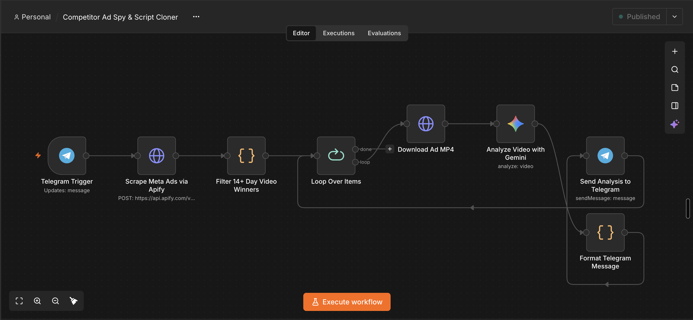
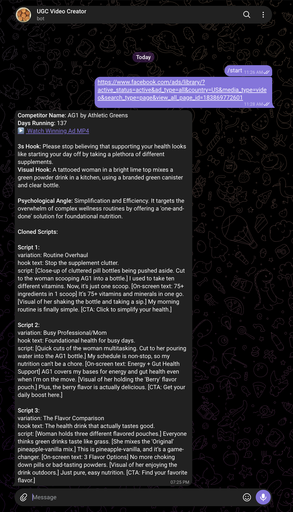

# Competitor Ad Spy & UGC Script Cloner: n8n + Apify + Gemini Video Analysis

> An automated n8n workflow that spies on competitor Meta (Facebook) Ad Libraries, filters 14+ day proven winning video ads, reverse-engineers their 3-second hooks and psychological angles using Google Gemini multimodal video AI, and delivers 3 ready-to-test UGC script variations directly to your Telegram chat.

[](https://n8n.io/)
[](https://apify.com/apify/facebook-ads-scraper)
[](https://ai.google.dev/)
[](https://core.telegram.org/bots/api)
[](https://opensource.org/licenses/MIT)

---

## What is this n8n workflow?

This is a production-grade **n8n automation** designed for direct-to-consumer (DTC) brands, performance media buyers, and creative strategists. 

Instead of guessing what creative concepts might work or manually scrolling through hundreds of competitor ads in the Facebook Ad Library, this workflow automates the entire **competitor intelligence and script ideation pipeline**:

1. **Trigger on Demand:** Paste a competitor's Facebook Ad Library URL into your private Telegram bot.
2. **Scrape Active Ads:** Calls Apify's Meta Ads Scraper to extract active ad creative data and direct video streams.
3. **Filter 14+ Day Winners:** An intelligent JavaScript filter discards short-lived test ads and surfaces only ads running for **14 or more days** (statistically proven, scaling winners that competitors are spending real ad budget on).
4. **Multimodal Video Understanding:** Downloads the top 3 longest-running ad MP4s and passes the raw video binaries to **Google Gemini** for frame-by-frame and audio analysis.
5. **Hook & Script Cloning:** Gemini breaks down the exact spoken hook in the first 3 seconds, the visual hook, the psychological angle, and generates **3 high-converting 20-second UGC script variations**.
6. **Instant Telegram Delivery:** Formats the findings into an ad intelligence card with a direct video link and delivers it straight to your Telegram chat.

---

## At a Glance

| Item | Details |
| :--- | :--- |
| **Platform** | n8n (n8n Cloud or self-hosted Docker / npm) |
| **Interface** | Telegram Bot (send Facebook Ad Library URL) |
| **Scraper** | [Apify Facebook Ads Scraper](https://apify.com/apify/facebook-ads-scraper) (`apify~facebook-ads-scraper`) |
| **Winner Threshold** | Active video ads running for **$\ge$ 14 days**, sorted by longevity |
| **AI Model** | Google Gemini (`models/gemini-3-flash-preview` / Gemini multimodal video) |
| **AI Input** | Native binary MP4 stream (analyzes audio dialogue + visual frame cues) |
| **Output Deliverable** | HTML Telegram card with 3s hook, visual cue, psychological trigger, and 3 cloned UGC scripts |
| **Processing Time** | ~30 to 60 seconds per winning ad |
| **Workflow File** | [`Competitor Ad Spy & Script Cloner.json`](./Competitor%20Ad%20Spy%20&%20Script%20Cloner.json) |
| **License** | MIT |

---

## Why the 14-Day Filter Matters

Most creative spy tools overwhelm media buyers with hundreds of new ads. The problem: **80% of launched ads fail within 48 to 72 hours**.

If a competitor has been paying to run a video ad continuously for **14, 30, or 100+ days**, it is virtually guaranteed to be a **profitable winner**. This workflow ignores all vanity and short-lived test ads, isolating only the proven creative formulas that drive revenue.

---

## Workflow Canvas & Architecture

<p align="center">
  
</p>
<p align="center">
  <em>The complete n8n workflow pipeline canvas: Telegram Trigger &rarr; Apify Meta Scraper &rarr; 14+ Day Winner Filter &rarr; Batch Loop &rarr; MP4 Downloader &rarr; Gemini Video Analysis &rarr; Telegram HTML Delivery.</em>
</p>

### Architecture Sequence

```mermaid
sequenceDiagram
    autonumber
    actor User as Media Buyer (Telegram)
    participant TG as Telegram Bot Node
    participant N8N as n8n Orchestrator
    participant Apify as Apify (Meta Ads Scraper)
    participant Code as Filter Node (14+ Days)
    participant Loop as Split in Batches
    participant VideoCDN as Ad Video Stream
    participant Gemini as Google Gemini (Video AI)

    User->>TG: Send Facebook Ad Library URL
    TG->>N8N: Extract message text & chat_id
    N8N->>Apify: POST /run-sync-get-dataset-items (Fetch active ads)
    Apify-->>N8N: 200 OK (Dataset items with video URLs & start dates)
    N8N->>Code: Filter for videoUrl & days_running >= 14
    Code-->>N8N: Top 3 longest running ads sorted descending
    N8N->>Loop: Initialize item loop (1 ad at a time)
    
    rect rgb(240, 248, 255)
        note over Loop,Gemini: Processing Each Winning Ad
        Loop->>VideoCDN: GET video_url (Download MP4 binary)
        VideoCDN-->>Loop: Stream MP4 binary file
        Loop->>Gemini: Analyze video binary (Prompt: 3s hook, visual, psychology, 3 scripts)
        Gemini-->>Loop: Strict JSON intelligence payload
        Loop->>TG: Send formatted HTML message + ad link + 3 cloned scripts
        TG-->>User: Telegram Intelligence Notification
    end
```

---

## Step-by-Step Node Breakdown

### 1. Telegram Trigger
* **Node Name:** `Telegram Trigger`
* Listens for inbound messages from authorized users.
* Accepts any Meta Ad Library URL (e.g., `https://www.facebook.com/ads/library/?active_status=active&ad_type=all&country=US&media_type=video&search_type=page&view_all_page_id=183869772601`).

### 2. Scrape Meta Ads via Apify
* **Node Name:** `Scrape Meta Ads via Apify`
* Uses an HTTP Request node to call Apify's `apify~facebook-ads-scraper` actor synchronously:
  ```json
  {
    "startUrls": [{"url": "{{ $json.message.text }}"}],
    "resultsLimit": 30,
    "activeStatus": "active"
  }
  ```
* Retrieves comprehensive ad snapshot data including start dates, page names, ad copy, and high-definition video URLs (`videoHdUrl`).

### 3. Filter 14+ Day Video Winners
* **Node Name:** `Filter 14+ Day Video Winners`
* JavaScript Code node that:
  * Verifies video presence across video snapshots and card carousels.
  * Calculates ad running duration: `daysRunning = Math.floor((Date.now() - startDate) / (24 * 60 * 60 * 1000))`.
  * Drops any ad running for fewer than 14 days (`daysRunning < 14`).
  * Sorts active ads by longevity in descending order (`b.days_running - a.days_running`).
  * Returns the **top 3 champions**.

### 4. Loop Over Items
* **Node Name:** `Loop Over Items` (`splitInBatches`)
* Processes winning ads sequentially (batch size: 1) to conserve n8n execution memory and avoid hitting AI provider rate limits.

### 5. Download Ad MP4
* **Node Name:** `Download Ad MP4`
* HTTP Request node configured with `responseFormat: "file"`.
* Downloads the direct competitor video file into n8n binary memory for multimodal inspection.

### 6. Analyze Video with Gemini
* **Node Name:** `Analyze Video with Gemini`
* Uses the `@n8n/n8n-nodes-langchain.googleGemini` node with `models/gemini-3-flash-preview` (or `gemini-2.5-flash` / `gemini-1.5-flash`).
* Accepts the raw MP4 binary stream directly.
* Instructs Gemini with direct-response creative guidelines:
  > *"Analyze this winning competitor video ad. Return strict JSON with: 1) spoken_hook_first_3s, 2) visual_hook_description, 3) psychological_angle, and 4) three cloned 20-second UGC video script variations (with [visual cues] and on-screen text hooks)."*

### 7. Format Telegram Message
* **Node Name:** `Format Telegram Message`
* JavaScript Code node that safely handles JSON parsing, strips markdown code wrappers, escapes HTML special characters, structures the output, and caps the message at 3,990 characters to respect Telegram's message limits.

### 8. Send Analysis to Telegram
* **Node Name:** `Send Analysis to Telegram`
* Sends the rich HTML report to the user's chat, including a clickable link to watch the raw winning ad MP4.
* Loops back to process the remaining winning ads.

---

## Live Output Example

Here is a real execution output from the bot analyzing an ad run by **AG1 (Athletic Greens)** running for **137 days**:

<p align="center">
  
</p>
<p align="center">
  <em>Live Telegram bot delivery: competitor ad intelligence, 3-second hook breakdown, psychological angles, and 3 cloned script variations.</em>
</p>

### Telegram Delivery Breakdown:

```text
Competitor Name: AG1 by Athletic Greens
Days Running: 137
▶️ Watch Winning Ad MP4

3s Hook: Please stop believing that supporting your health looks like starting your day off by taking a plethora of different supplements.

Visual Hook: A tattooed woman in a bright lime top mixes a green powder drink in a kitchen, using a branded green canister and clear bottle.

Psychological Angle: Simplification and Efficiency. It targets the overwhelm of complex wellness routines by offering a 'one-and-done' solution for foundational nutrition.

Cloned Scripts:

Script 1:
variation: Routine Overhaul
hook text: Stop the supplement clutter.
script: [Close-up of cluttered pill bottles being pushed aside. Cut to the woman scooping AG1 into a bottle.] I used to take ten different vitamins. Now, it's just one scoop. [On-screen text: 75+ ingredients in 1 scoop] It's 75+ vitamins and minerals in one go. [Visual of her shaking the bottle and taking a sip.] My morning routine is finally simple. [CTA: Click to simplify your health.]

Script 2:
variation: Busy Professional/Mom
hook text: Foundational health for busy days.
script: [Quick cuts of the woman multitasking. Cut to her pouring water into the AG1 bottle.] My schedule is non-stop, so my nutrition can't be a chore. [On-screen text: Energy + Gut Health Support] AG1 covers my bases for energy and gut health even when I'm on the move. [Visual of her holding the 'Berry' flavor pouch.] Plus, the berry flavor is actually delicious. [CTA: Get your daily boost here.]

Script 3:
variation: The Flavor Comparison
hook text: The health drink that actually tastes good.
script: [Woman holds three different flavored pouches.] Everyone thinks green drinks taste like grass. [She mixes the 'Original' pineapple-vanilla mix.] This is pineapple-vanilla, and it's a game-changer. [On-screen text: 3 Flavor Options] No more choking down pills or bad-tasting powders. [Visual of her enjoying the drink outdoors.] Just pure, easy nutrition. [CTA: Find your favorite flavor.]
```

---

## Quick Start (5 Minutes)

### 1. Clone the repository

```bash
git clone https://github.com/TechGenDM/Video-Generation-With-Gemini.git
cd Video-Generation-With-Gemini
```

### 2. Set Up Credentials in n8n

Open your n8n instance and navigate to **Credentials**:

1. **Telegram API:** Create a bot via [@BotFather](https://t.me/BotFather) and paste your Bot Token.
2. **Apify API Token (Header Auth):** 
   * Obtain an API token from your [Apify Console](https://console.apify.com/account/integrations).
   * Create an n8n credential of type **Custom Auth / Header Auth** (or Apify token).
   * Header name: `Authorization`
   * Value: `Bearer <YOUR_APIFY_TOKEN>`
3. **Google Gemini (PaLM) API:**
   * Get an API key from [Google AI Studio](https://aistudio.google.com/).
   * Create a **Google Gemini (PaLM) Api** credential in n8n and paste your API key.

### 3. Import the Workflow

1. In n8n, click the **Workflows** menu (top-right `...` or `+`).
2. Choose **Import from File**.
3. Select [`Competitor Ad Spy & Script Cloner.json`](./Competitor%20Ad%20Spy%20&%20Script%20Cloner.json).

### 4. Bind Credentials & Activate

1. Double-check that your credentials are bound to:
   * `Telegram Trigger` & `Send Analysis to Telegram` (Telegram credential)
   * `Scrape Meta Ads via Apify` (Apify credential)
   * `Analyze Video with Gemini` (Gemini credential)
2. Toggle the workflow to **Active**.
3. Open Telegram and send your bot any Facebook Ad Library link!

---

## How to Get Competitor Ad Library URLs

1. Go to the [Meta Ad Library](https://www.facebook.com/ads/library/).
2. Select your target country and category (**All Ads**).
3. Search for your competitor's page (e.g., *Athletic Greens*, *Hims*, *Cirkul*).
4. Apply the filter: **Media Type &rarr; Videos**, and **Status &rarr; Active ads**.
5. Copy the URL from your browser's address bar and send it to your bot.

---

## Requirements

* **n8n:** Version `1.50.0` or newer (Cloud or self-hosted).
* **Apify Account:** Standard plan or free credits for running `apify~facebook-ads-scraper`.
* **Google Gemini API Key:** Requires access to Gemini multimodal video models (`gemini-3-flash-preview`, `gemini-2.5-flash`, or `gemini-1.5-flash`).
* **Telegram Bot:** Configured with permissions to read and send messages.

---

## Best Practices

* **Batching & Execution Limits:** The workflow analyzes the top 3 longest-running ads by default. You can adjust `results.slice(0, 3)` in [Filter 14+ Day Video Winners](./Competitor%20Ad%20Spy%20&%20Script%20Cloner.json#L57) if you want to analyze more or fewer ads per execution.
* **Apify Actor Limits:** The Apify node sets `"resultsLimit": 30` to keep execution quick and cost-efficient.
* **Gemini Model Configuration:** If `models/gemini-3-flash-preview` is unavailable or deprecates, switch the model selector in the Gemini node to `models/gemini-2.5-flash` or `models/gemini-1.5-flash`.

---

## Troubleshooting

| Problem | Cause | Solution |
| :--- | :--- | :--- |
| **Apify returns 0 items** | Competitor has no active video ads or URL is invalid. | Verify that the Facebook Ad Library page has active video ads running. |
| **No ads pass the filter** | Competitor ads are all newer than 14 days. | Lower the threshold in the Code node from `daysRunning < 14` to `daysRunning < 7` for newer brands. |
| **Gemini video error** | Ad MP4 file was corrupted or exceeds size limits. | Ensure the video download node has a 120s timeout and sufficient memory. |
| **Telegram message truncated** | Analysis text exceeded 4,096 characters. | The Code node automatically safely truncates at 3,990 characters to avoid delivery failures. |

---

## Roadmap

- [x] Facebook Ad Library scraper via Apify
- [x] Automated 14+ day winner filter
- [x] Multimodal video hook & psychology extraction with Gemini
- [x] 3 cloned UGC script variations delivered to Telegram
- [ ] **AI Video Generation Integration:** Route cloned scripts into Google Veo 3 / HeyGen / ElevenLabs to auto-generate draft UGC test ads.
- [ ] **TikTok Creative Center Integration:** Scrape top trending TikTok video ads alongside Meta.
- [ ] **Airtable / Google Sheets Sync:** Automatically log competitor intelligence and scripts into a shared creative swipe file.

---

## Author

Built by [TechGenDM](https://github.com/TechGenDM). Issues and feature requests are welcome via [GitHub Issues](https://github.com/TechGenDM/Video-Generation-With-Gemini/issues).

If this automation helps you scale your ad creative workflow, please give this repository a ⭐!

---

## License

Distributed under the [MIT License](https://opensource.org/licenses/MIT). You are free to adapt and use this workflow for personal and commercial automation projects.

---

## Keywords

competitor ad spy n8n workflow, meta ad library scraper, facebook ads scraper apify, gemini video ai analysis, ugc script generator, direct response creative strategy, paid social ad hooks, n8n telegram bot automation, 3-second hook analysis, ugc video ad cloner, dtc creative research tool, ai media buyer workflow, viral ad breakdown, performance marketing automation.