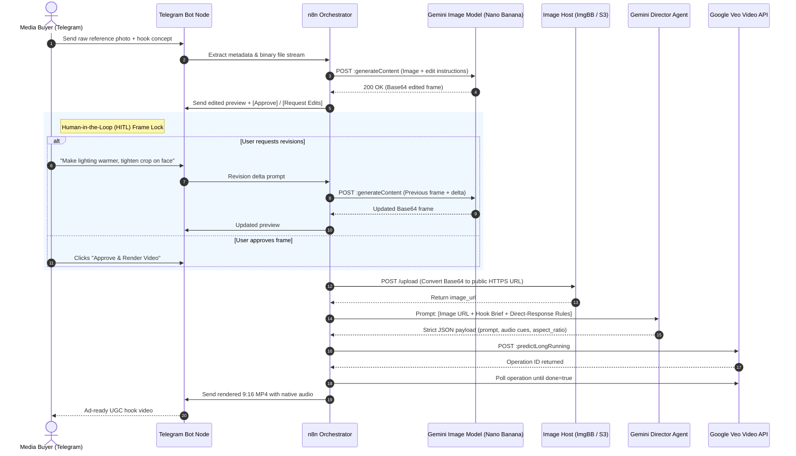

# AI UGC Video Ad Generator: n8n + Gemini Veo 3 + Telegram

> An n8n workflow that turns one photo and a hook idea into an 8-second vertical (9:16) AI video ad with sound, using Gemini, Google Veo and Telegram approval.

[](https://n8n.io/)
[](https://ai.google.dev/)
[](https://ai.google.dev/)
[](https://core.telegram.org/bots/api)
[](https://opensource.org/licenses/MIT)

## What is this n8n workflow?

This is a human-in-the-loop (HITL) **n8n workflow** for creating short **UGC-style video hooks** for paid social ads (Meta Reels, TikTok, YouTube Shorts). You send a reference photo and a hook idea to a **Telegram bot**. The workflow edits the photo with a **Gemini image model (Nano Banana)**, and you approve or change the frame in Telegram. Only after you approve does it write a video prompt with a **Gemini "Director" agent** and render a **9:16 video with native audio** using **Google Veo**.

**Who it is for:** DTC paid-social agencies, e-commerce media buyers, and creative strategists who want to test many ad hooks quickly.

**The problem it solves:**

- Waiting days for a creator video makes hook testing slow and expensive.
- Blind text-to-video prompting wastes video credits on frames you cannot use.

**The fix:** lock the look of the first frame with cheap image edits first. Spend video credits only on a frame you have already approved.

## At a glance

| Item | Details |
| --- | --- |
| Platform | n8n (n8n Cloud or self-hosted) |
| Interface | Telegram bot with inline approve / edit buttons |
| Image editing | Gemini image model ("Nano Banana") |
| Video generation | Google Veo, image-to-video, 9:16, 8 seconds, native audio |
| Prompt writer | Gemini "Director" agent that returns strict JSON |
| Image hosting | ImgBB, Cloudinary or AWS S3 |
| Veo render time | About 40 to 90 seconds in our runs |
| License | MIT |

## Model versions (read this first)

Google renames and retires model IDs often. This workflow was first built with `gemini-2.5-flash-image-preview` and `veo-3.0-generate-preview`. Google's deprecations page lists those preview IDs as retired. As of October 2026, it points to `gemini-3.1-flash-image` for image editing and `veo-3.1-generate-preview` / `veo-3.1-fast-generate-preview` for video.

Set the model IDs in your `.env` file (see [Environment variables](#environment-variables)) and check the current list at [Gemini API deprecations](https://ai.google.dev/gemini-api/docs/deprecations). A `404` or "model not found" error from Google usually means a retired model ID.

*Last checked: October 2026.*

## Quick start (5 minutes)

1. **Clone the repo**

   ```bash
   git clone https://github.com/TechGenDM/Video-Generation-With-Gemini.git
   cd Video-Generation-With-Gemini
   ```

2. **Add credentials in n8n** (Credentials menu):
   - A **Telegram API** credential with your bot token (create the bot with [@BotFather](https://t.me/BotFather)).
   - A **Google Gemini (PaLM) API** credential, or a **Header Auth** credential with `x-goog-api-key: <your Gemini API key>`.

3. **Import the workflow:** in n8n, open the workflow menu (⋮), choose **Import from File**, and select `Competitor Ad Spy & Script Cloner.json`.

4. **Fill in your environment variables** (copy the example below into `.env` or your n8n environment settings).

5. **Bind credentials and activate:** attach your saved credentials to each highlighted node, activate the workflow, then send a photo with a caption to your Telegram bot.

## How the workflow works

<p align="center">
  
</p>
<p align="center">
  <em>The complete n8n workflow pipeline canvas: listening for Telegram triggers, filtering winning competitor ads, and orchestrating Gemini AI analysis.</em>
</p>



### 1. Telegram ingestion and session handling

- **Trigger:** a Telegram Trigger node listens for photo uploads and button presses (`message`, `callback_query`).
- **Metadata:** it extracts `file_id`, `chat_id`, `user_id` and the caption.
- **File retrieval:** it calls Telegram's `getFile` endpoint to load the photo into n8n.

### 2. Gemini image editing loop (Nano Banana)

- **Edit:** the photo and your edit instruction go to the Gemini image model for character-consistent styling, background changes or lighting changes.
- **Convert:** an n8n **Code node** turns the returned Base64 string (`inlineData.data`) back into an n8n binary file.
- **Approve:** the edited frame goes to Telegram with two inline buttons: `Approve & Render Video` and `Request Further Edits`.
- **Loop:** edit requests go back to the image model with the previous frame. An approval moves on to hosting.

### 3. Image hosting and URL conversion

- **Why:** passing large Base64 strings through `Wait` and polling nodes uses a lot of memory and fills the n8n execution database.
- **What it does:** the approved frame is uploaded to ImgBB, Cloudinary or AWS S3. From then on the workflow only passes a short HTTPS URL.

### 4. Gemini Director agent

- **Role:** acts as a direct-response paid-social creative director.
- **Input:** the approved frame URL, your hook idea, the target length (8 seconds) and the Veo audio and visual rules.
- **Output:** a strict JSON payload with the first-3-seconds motion, handheld camera movement, ambient audio and spoken dialogue.

### 5. Google Veo video and native audio

- **Input:** the Director's `prompt`, the approved starter frame as `image`, `aspectRatio` of `9:16`, a clip length of 8 seconds, and audio generation turned on.
- **Polling:** an n8n `Wait` node (10 seconds) and an `IF` node check the long-running operation until `done` is `true`. A counter stops the loop after 12 attempts.

### 6. Delivery in Telegram

- The workflow formats the intelligence breakdown, extracts key hook psychology, and delivers the ready-to-test script variations directly to your Telegram chat.

<p align="center">
  
</p>
<p align="center">
  <em>Live Telegram bot delivery: competitor ad intelligence, 3-second hook breakdown, psychological angles, and 3 cloned script variations.</em>
</p>

## Requirements

- **n8n:** n8n Cloud or self-hosted (Docker or npm). Version `1.50.0` or newer is recommended.
- **Telegram bot:** a bot token from [@BotFather](https://t.me/BotFather).
- **Google AI Studio or Vertex AI API key:** a paid project with access to a Gemini image model, a Gemini text model for the Director, and a Veo model.
- **Image host:** an ImgBB API key, a Cloudinary account, or an AWS S3 bucket.

## Environment variables

Add these to your `.env` file or n8n environment settings. Never commit real keys to GitHub.

```env
# Telegram
TELEGRAM_BOT_TOKEN=your_telegram_bot_token

# Google Gemini and Veo (Google AI Studio)
GEMINI_API_KEY=your_gemini_api_key

# Model IDs change often. Check the "Model versions" section before you run.
GEMINI_IMAGE_ENDPOINT=https://generativelanguage.googleapis.com/v1beta/models/gemini-3.1-flash-image:generateContent
GEMINI_VEO_ENDPOINT=https://generativelanguage.googleapis.com/v1beta/models/veo-3.1-fast-generate-preview:predictLongRunning

# Image host (example: ImgBB)
IMAGE_HOST_API_KEY=your_imgbb_api_key
IMAGE_HOST_UPLOAD_URL=https://api.imgbb.com/1/upload
```

## Director agent prompt and JSON schema

The Director node uses a Gemini text model (the original build used Gemini 2.5 Pro) with `responseMimeType: "application/json"` and this system prompt:

```text
You are a Lead Direct-Response UGC Video Director optimizing for Meta and TikTok 3-second Thumb-Stop Rate.
Transform the user's creative concept and reference image into a hyper-realistic, 8-second mobile-first (9:16) video generation payload for Google Veo.

Rules:
1. Always optimize for vertical mobile viewing (9:16 portrait).
2. Ground all initial visual action in the provided reference image to guarantee frame-1 continuity.
3. Engineer the first 2.5 seconds for maximum scroll-stopping motion (e.g., expressive micro-reaction, stepping into frame, handheld camera push-in).
4. Include explicit native audio cues in the prompt: specify natural ambient background sound and exact spoken dialogue in quotes if applicable.
5. Output strictly valid JSON matching the schema below with zero markdown wrappers.
```

**Output schema:**

```json
{
  "$schema": "http://json-schema.org/draft-07/schema#",
  "title": "VeoVideoGenerationPayload",
  "type": "object",
  "properties": {
    "model": {
      "type": "string",
      "description": "Current Veo model ID, for example veo-3.1-fast-generate-preview."
    },
    "aspect_ratio": {
      "type": "string",
      "enum": ["9:16", "16:9"],
      "default": "9:16"
    },
    "duration_seconds": {
      "type": "integer",
      "description": "Clip length in seconds. This workflow uses 8.",
      "default": 8
    },
    "generate_audio": {
      "type": "boolean",
      "default": true
    },
    "prompt": {
      "type": "string",
      "description": "UGC video prompt describing the 0-3s visual hook, camera motion, lighting, ambient audio and spoken dialogue."
    },
    "image_url": {
      "type": "string",
      "format": "uri",
      "description": "Direct public HTTPS URL of the approved starter frame."
    }
  },
  "required": ["model", "aspect_ratio", "duration_seconds", "generate_audio", "prompt", "image_url"]
}
```

**Example output:**

```json
{
  "model": "veo-3.1-fast-generate-preview",
  "aspect_ratio": "9:16",
  "duration_seconds": 8,
  "generate_audio": true,
  "prompt": "Authentic UGC smartphone selfie video on a sun-drenched Montana ranch at golden hour. In the first 2 seconds, a rugged cowboy in worn denim and a Stetson hat tilts his hat up and leans slightly toward the front-facing lens with a charismatic smirk. Subtle handheld smartphone camera wobble with warm sunset lens flare and floating dust motes. Audio: gentle dry wind rustling across open pasture, leather creaking softly, and the man speaking clearly in a warm gravelly voice: 'Most folks get out-of-state ranch work completely wrong.'",
  "image_url": "https://i.ibb.co/wN1K9Xp/cowboy-approved-frame.jpg"
}
```

## Example: cowboy lifestyle UGC hook

1. **You send** a raw photo of a man in a jacket with the caption: *"Turn this into a vintage Montana rancher UGC hook at golden hour."*
2. **Edit 1 (Nano Banana):** adds weathered denim, a sun-bleached Stetson hat and warm ranch backlighting.
3. **Your feedback:** *"Love the hat. Make the sunset warmer and add floating dust particles."*
4. **Edit 2:** warmer color temperature and floating dust motes. You tap `Approve & Render Video`.
5. **Hosting:** the approved frame is uploaded and becomes `https://i.ibb.co/wN1K9Xp/cowboy-approved-frame.jpg`.
6. **Director and Veo:** the Director writes the 8-second prompt with spoken dialogue and ranch ambience. Veo renders the 9:16 MP4 and the bot sends `cowboy_ugc_hook.mp4` back to your Telegram chat.

## Best practices

### Keep large Base64 data out of n8n memory

Passing raw Base64 strings through several `Wait` and polling nodes slows n8n down. Convert the image to binary once, upload it as soon as you approve it, and pass only the `image_url` string through the rest of the workflow.

### Poll Veo with a cap

Video generation usually takes 40 to 90 seconds. Use a `Wait` node set to 10 seconds, an `IF` node that checks `{{ $json.done === true }}`, and a counter that stops at 12 attempts. This prevents an endless loop if Google's API is slow.

### Force strict JSON from the Director

Turn on JSON output mode (`responseMimeType: "application/json"`) on the Director node. Later HTTP Request nodes can then read `{{ $json.prompt }}` directly, with no text cleanup.

## FAQ and troubleshooting

**Does this n8n workflow work on n8n Cloud?**
Yes. It uses standard n8n nodes (Telegram, HTTP Request, Code, Wait, IF), so it runs on n8n Cloud or self-hosted n8n.

**Why approve an image before making the video?**
Image edits cost much less than video renders and finish faster. Locking the lighting, outfit and framing on a still means your video credits go to frames you have already approved. Prices change, so check Google's current pricing page for exact numbers.

**I get a 404 or "model not found" error from Google.**
The model ID is probably retired. Update `GEMINI_IMAGE_ENDPOINT` and `GEMINI_VEO_ENDPOINT` using the [Model versions](#model-versions-read-this-first) section and Google's [deprecations page](https://ai.google.dev/gemini-api/docs/deprecations). If your Director node's JSON schema lists old model IDs, update it too.

**Gemini returns Base64, but my image uploader needs binary data.**
Add an n8n **Code** node right after the Gemini HTTP Request node:

```javascript
const base64Data = $json.candidates[0].content.parts.find(p => p.inlineData)?.inlineData.data;

return [{
  binary: {
    data: {
      data: base64Data,
      mimeType: 'image/jpeg',
      fileName: 'approved_frame.jpg'
    }
  },
  json: { ...$json }
}];
```

Then set the upload node to send the binary property named `data`.

**Video generation fails with "Invalid Image URL".**
Make sure your image host returns the direct file URL (ending in `.jpg`, `.png` or `.webp`), not an HTML viewer page.

**How do I change the aspect ratio or video length?**
This workflow is set to 9:16 and 8 seconds. Change the defaults in the Director prompt and schema, then check Google's Veo documentation for the lengths and ratios your chosen model supports.

**Veo polling times out or returns a 429 error.**
Keep the `Wait` interval at 10 seconds or more and cap `max_attempts` at 12 to 15. For 429 errors, check your Google AI Studio or Vertex AI quota for the Veo model you use.

**Can I use a different AI model for the Director step?**
The Director is a normal n8n step that must return strict JSON, so another LLM with JSON output can replace it. This has not been tested here. The image editing and video steps still use Google models.

## Roadmap

- [ ] **3-hook split-test batching:** generate three different 5-second hook angles (contrarian, shock reaction, text-overlay point) from one approved frame.
- [ ] **Competitor ad research:** connect an Apify Meta Ad Library scraper to copy the structure of winning competitor hooks.
- [ ] **Auto-captions:** pass the rendered MP4 through a subtitle webhook for animated word-by-word captions.

## Learn more

- [n8n documentation](https://docs.n8n.io/)
- [Gemini API deprecations and model replacements](https://ai.google.dev/gemini-api/docs/deprecations)
- [Telegram Bot API](https://core.telegram.org/bots/api)

## Author

Built by [TechGenDM](https://github.com/TechGenDM). Questions and ideas are welcome in [GitHub Issues](https://github.com/TechGenDM/Video-Generation-With-Gemini/issues).

If this workflow helps you, please star the repo.

## License

Released under the [MIT License](https://opensource.org/licenses/MIT). You can use and adapt it in personal and commercial automation projects.