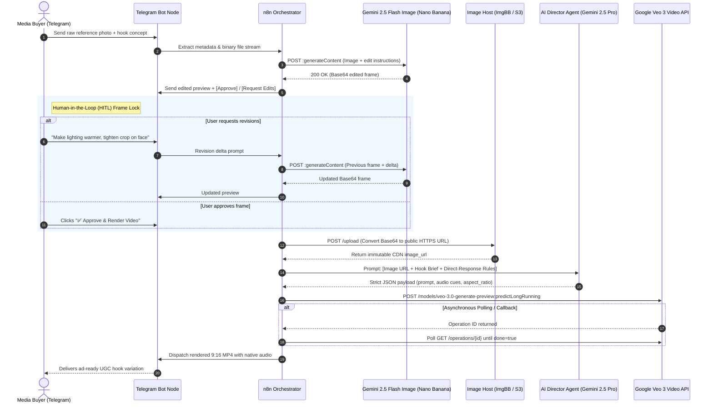

# 🎬 AI Paid-Social UGC Hook & Video Pipeline (n8n + Gemini Veo 3)

[](https://n8n.io/)
[](https://ai.google.dev/)
[](https://ai.google.dev/)
[](https://core.telegram.org/bots/api)
[](https://opensource.org/licenses/MIT)

An autonomous, Human-in-the-Loop (HITL) paid-social video hook and B-roll generation pipeline built with **n8n**, **Telegram**, **Gemini 2.5 Flash Image (Nano Banana)**, and **Google Veo 3 (`veo-3.0-generate-preview`)**.

Built for **DTC Paid Social Agencies and E-Commerce Media Buyers**, this pipeline solves two major bottlenecks in ad creative testing: **high video API burn rates** and **slow creator turnaround times**. By locking visual composition through cheap interactive image iterations in Telegram before triggering expensive video renders, teams cut wasted video generation spend by ~70% while producing mobile-first (`9:16`) video hooks with native synchronized audio in under 2 minutes.

---

## 📌 Table of Contents

- [Overview & Target Use Case](#-overview--target-use-case)
- [Architecture & System Flow](#-architecture--system-flow)
- [Key Engineering Features](#-key-engineering-features)
- [Workflow Pipeline Breakdown](#-workflow-pipeline-breakdown)
  - [1. Telegram Ingestion & Session Handling](#1-telegram-ingestion--session-handling)
  - [2. Gemini 2.5 Flash Image ("Nano Banana") HITL Loop](#2-gemini-25-flash-image-nano-banana-hitl-loop)
  - [3. Asset Hosting & URL Conversion](#3-asset-hosting--url-conversion)
  - [4. AI Paid-Social Director Agent](#4-ai-paid-social-director-agent)
  - [5. Google Veo 3 Video & Native Audio Synthesis](#5-google-veo-3-video--native-audio-synthesis)
  - [6. Result Delivery & Telegram Dispatch](#6-result-delivery--telegram-dispatch)
- [AI Director Agent Prompt & JSON Schema](#-ai-director-agent-prompt--json-schema)
- [Prerequisites & Environment Configuration](#-prerequisites--environment-configuration)
- [Setup & Deployment Guide](#-setup--deployment-guide)
- [Engineering Best Practices & Gotchas](#-engineering-best-practices--gotchas)
- [Example Scenario: Cowboy Lifestyle UGC Hook](#-example-scenario-cowboy-lifestyle-ugc-hook)
- [Troubleshooting & FAQs](#-troubleshooting--faqs)
- [Roadmap & Enhancements](#-roadmap--enhancements)
- [License](#-license)

---

## 🚀 Overview & Target Use Case

In paid social (Meta Reels, TikTok, YouTube Shorts), **Thumb-Stop Rate (3-second view-through)** determines campaign profitability. Waiting 7 days and paying $150–$300 per creator video makes rapid hook testing slow and expensive, while blind text-to-video prompting burns API credits on unusable frames.

This pipeline automates the creative testing workflow through a single Telegram interface:

1. **Telegram Trigger**: A media buyer or creative strategist uploads a reference image or product/lifestyle shot with a creative angle.
2. **HITL Frame-Lock (Nano Banana / Gemini 2.5 Flash Image)**: The image is routed to Gemini's native image editing model for targeted visual adjustments. The preview returns to Telegram with interactive approval buttons—allowing unlimited low-cost image tweaks before spending video credits.
3. **Direct CDN Resolution**: Once approved, the binary/Base64 frame is uploaded to a high-speed CDN (ImgBB / S3) to keep n8n's execution database lightweight.
4. **AI Director Synthesis**: An LLM agent acts as a Direct-Response Video Director, converting the approved starter frame and brief into a structured JSON payload with camera movement, pacing, and native audio cues.
5. **Veo 3 Video + Audio Generation**: Google's Veo 3 model renders a high-realism, 8-second `9:16` vertical video complete with synchronized ambient audio and spoken dialogue.
6. **Instant Delivery**: The finished MP4 is pushed back to Telegram ready for split-testing in Meta Ads Manager or CapCut.

---

## 🏗 Architecture & System Flow



---

## ✨ Key Engineering Features

* **💰 Cost-Controlled HITL Gate**: Prevents wasted $0.35–$0.50+ video renders by locking lighting, wardrobe, and framing at the image stage (~$0.03/edit) via Telegram inline keyboards.
* **📱 Native `9:16` Vertical Output**: Engineered specifically for Meta Reels, TikTok, and YouTube Shorts placements with native spoken hooks and ambient sound design via Veo 3.
* **⚡ Zero-Bloat Binary Management**: Eliminates n8n PostgreSQL/SQLite execution bloat by offloading Base64 blobs to external CDN storage before entering asynchronous polling loops.
* **🧠 Deterministic JSON Agent**: Enforces `responseMimeType: "application/json"` on the Director Agent so downstream HTTP payloads never fail due to markdown wrapper hallucinations.

---

## ⚙ Workflow Pipeline Breakdown

### 1. Telegram Ingestion & Session Handling

* **Trigger**: Telegram Trigger Node listening for incoming photo uploads and callback queries (`message`, `callback_query`).
* **Metadata Extraction**: Extracts `file_id`, `chat_id`, `user_id`, and caption instructions.
* **File Retrieval**: Calls Telegram's `getFile` endpoint to pull the raw binary asset into n8n's transient memory.

### 2. Gemini 2.5 Flash Image ("Nano Banana") HITL Loop

* **API Integration**: Sends the inline Base64 image and revision prompt to Google's `gemini-2.5-flash-image-preview` endpoint for character-consistent styling, background replacement, or lighting edits.
* **Conversion Utility**: A dedicated n8n **Code Node** converts the returned `inlineData.data` Base64 string back into an n8n binary buffer.
* **Telegram Interactive Prompt**: Dispatches the edited frame to Telegram with inline buttons (`✅ Approve & Render Video`, `✏️ Request Further Edits`).
* **Loop Controller**: Routes edit requests back into the image model with conversational memory, or advances approved frames to CDN upload.

### 3. Asset Hosting & URL Conversion

* **Why It Matters**: Passing multi-megabyte Base64 strings across asynchronous `Wait` and polling nodes spikes RAM usage and slows down n8n execution history.
* **Hosting Node**: Uploads the approved binary to ImgBB, Cloudinary, or AWS S3 and outputs a lightweight HTTPS URL (`https://i.ibb.co/xyz/approved-frame.jpg`).

### 4. AI Paid-Social Director Agent

* **Role**: Acts as a Direct-Response Paid Social Creative Director.
* **Input Context**: Combines the approved reference frame, user hook concept, target duration (8 seconds), and Veo 3 audio/visual syntax rules.
* **Output**: Produces a strict JSON specification detailing first-3-second thumb-stop motion, handheld camera physics, ambient audio, and spoken dialogue.

### 5. Google Veo 3 Video & Native Audio Synthesis

* **Model**: Google Veo 3 (`veo-3.0-generate-preview` / `veo-3.0-fast-generate-preview`).
* **Input Parameters**:
  * `prompt`: Expanded cinematic + audio instruction from the Director Agent.
  * `image`: Approved starter frame passed via URL or binary reference.
  * `aspectRatio`: `"9:16"` (portrait) or `"16:9"` (landscape).
  * `durationSeconds`: `8` (optimized for paid-social hook retention).
  * `generateAudio`: `true` (synthesizes native speech and environmental sound effects).
* **Async Operation Handling**: Uses n8n's `Wait` + `IF` loop to poll the long-running operation endpoint every 10 seconds until `done: true`.

### 6. Result Delivery & Telegram Dispatch

* Fetches the signed video URI from the completed operation response and sends the MP4 directly to the user's Telegram chat via the `sendVideo` operation alongside the prompt breakdown.

---

## 🧠 AI Director Agent Prompt & JSON Schema

The workflow configures Gemini 2.5 Pro with `responseMimeType: "application/json"` and the following system prompt:

### System Prompt

```text
You are a Lead Direct-Response UGC Video Director optimizing for Meta and TikTok 3-second Thumb-Stop Rate.
Transform the user's creative concept and reference image into a hyper-realistic, 8-second mobile-first (9:16) video generation payload for Google Veo 3.

Rules:
1. Always optimize for vertical mobile viewing (9:16 portrait).
2. Ground all initial visual action in the provided reference image to guarantee frame-1 continuity.
3. Engineer the first 2.5 seconds for maximum scroll-stopping motion (e.g., expressive micro-reaction, stepping into frame, handheld camera push-in).
4. Include explicit native audio cues in the prompt: specify natural ambient background sound and exact spoken dialogue in quotes if applicable.
5. Output strictly valid JSON matching the schema below with zero markdown wrappers.
```

### JSON Schema Output Specification

```json
{
  "$schema": "http://json-schema.org/draft-07/schema#",
  "title": "Veo3VideoGenerationPayload",
  "type": "object",
  "properties": {
    "model": {
      "type": "string",
      "enum": ["veo-3.0-fast-generate-preview", "veo-3.0-generate-preview"],
      "default": "veo-3.0-fast-generate-preview"
    },
    "aspect_ratio": {
      "type": "string",
      "enum": ["9:16", "16:9"],
      "default": "9:16"
    },
    "duration_seconds": {
      "type": "integer",
      "enum": [5, 8],
      "default": 8
    },
    "generate_audio": {
      "type": "boolean",
      "default": true
    },
    "prompt": {
      "type": "string",
      "description": "High-fidelity UGC video prompt describing 0-3s visual hook, camera motion, lighting, ambient audio, and spoken dialogue."
    },
    "image_url": {
      "type": "string",
      "format": "uri",
      "description": "Direct public HTTPS URL of the approved starter frame."
    }
  },
  "required": ["model", "aspect_ratio", "duration_seconds", "generate_audio", "prompt", "image_url"]
}
```

### Example Generated Output

```json
{
  "model": "veo-3.0-fast-generate-preview",
  "aspect_ratio": "9:16",
  "duration_seconds": 8,
  "generate_audio": true,
  "prompt": "Authentic UGC smartphone selfie video on a sun-drenched Montana ranch at golden hour. In the first 2 seconds, a rugged cowboy in worn denim and a Stetson hat tilts his hat up and leans slightly toward the front-facing lens with a charismatic smirk. Subtle handheld smartphone camera wobble with warm sunset lens flare and floating dust motes. Audio: gentle dry wind rustling across open pasture, leather creaking softly, and the man speaking clearly in a warm gravelly voice: 'Most folks get out-of-state ranch work completely wrong.'",
  "image_url": "https://i.ibb.co/wN1K9Xp/cowboy-approved-frame.jpg"
}
```

---

## 📋 Prerequisites & Environment Configuration

### Required Accounts & Services

* **n8n**: Self-hosted (Docker / npm) or n8n Cloud (`v1.50.0+` recommended).
* **Telegram Bot**: Created via [@BotFather](https://t.me/BotFather) with an active API Token.
* **Google AI Studio / Vertex AI API Key**: Paid-tier project with access to `gemini-2.5-flash-image-preview` (Nano Banana), `gemini-2.5-pro`, and `veo-3.0-generate-preview`.
* **Image Hosting Service**: ImgBB API key, Cloudinary, or AWS S3 bucket.

### Environment Variables (`.env`)

Define these variables in your `.env` file or n8n environment configuration:

```env
# Telegram Configuration
TELEGRAM_BOT_TOKEN=7891234567:AAFnYourTelegramBotTokenHere

# Google Gemini & Veo 3 Configuration (Google AI Studio)
GEMINI_API_KEY=AIzaSyYourGeminiApiKeyHere
GEMINI_IMAGE_ENDPOINT=https://generativelanguage.googleapis.com/v1beta/models/gemini-2.5-flash-image-preview:generateContent
GEMINI_VEO_ENDPOINT=https://generativelanguage.googleapis.com/v1beta/models/veo-3.0-fast-generate-preview:predictLongRunning

# Image Hosting Configuration (e.g., ImgBB)
IMAGE_HOST_API_KEY=your_imgbb_api_key_here
IMAGE_HOST_UPLOAD_URL=https://api.imgbb.com/1/upload
```

---

## 🛠 Setup & Deployment Guide

### Step 1: Clone Repository

```bash
git clone https://github.com/TechGenDM/Video-Generation-With-Gemini.git
cd Video-Generation-With-Gemini
```

### Step 2: Configure Credentials in n8n

1. Open **Credentials** in your n8n workspace.
2. Add a **Telegram API** credential using your `TELEGRAM_BOT_TOKEN`.
3. Add a **Google Gemini (PaLM) API** credential (or **Header Auth** with `x-goog-api-key: <GEMINI_API_KEY>`) for the Image, Director Agent, and Veo 3 HTTP nodes.

### Step 3: Import n8n Workflow

1. Create a new workflow in n8n.
2. Click **Workflow Menu (⋮) > Import from File** and select `workflows/ugc_gemini_video_pipeline.json` (or paste your exported workflow JSON).
3. Bind your saved Telegram and Google Gemini credentials to each highlighted node and activate the workflow.

---

## 💡 Engineering Best Practices & Gotchas

### 1. Handling Large Binary & Base64 Payloads

> [!WARNING]
> Passing raw Base64 strings through multiple `Wait` and polling nodes bloats n8n memory and slows down PostgreSQL/SQLite execution storage.

* **Offload to CDN Immediately**: Convert Base64 image responses to a binary buffer only once, upload to ImgBB/S3 upon user approval, and pass only the lightweight `image_url` string through the rest of the workflow.

### 2. Managing Asynchronous Veo 3 Polling

* Video generation typically takes **40 to 90 seconds**.
* Use an n8n `Wait` node (set to `10 seconds`) paired with an `IF` node checking `{{ $json.done === true }}` and a loop counter cap (`max_attempts <= 12`) so congested upstream APIs never cause infinite execution locks.

### 3. Enforcing Strict JSON from the Director Agent

* Always enable **JSON Output Mode** (`responseMimeType: "application/json"`) on the Gemini Director node so downstream HTTP Request nodes can reference `{{ $json.prompt }}` without regex stripping.

---

## 🤠 Example Scenario: Cowboy Lifestyle UGC Hook

### 1. Initial Prompt & Image (Telegram)

* **User sends**: A raw photo of a man in a jacket + caption: *"Turn this into a vintage Montana rancher UGC hook at golden hour."*

### 2. Nano Banana (Gemini 2.5 Flash Image) Iteration

* **Edit 1**: Adds weathered denim texture, a sun-bleached Stetson hat, and warm ranch backlighting.
* **User Feedback**: *"Love the hat—make the sunset warmer and add floating dust particles."*
* **Edit 2**: Updates color temperature and atmospheric dust motes.
* **User Action**: Clicks `✅ Approve & Render Video`.

### 3. Hosted URL Conversion

* The approved frame is uploaded to CDN:
```text
https://i.ibb.co/wN1K9Xp/cowboy-approved-frame.jpg
```

### 4. Director Agent & Veo 3 Synthesis

* The Director Agent constructs the 8-second hook prompt with spoken dialogue and ambient ranch audio.
* Veo 3 renders the `9:16` MP4 with synchronized speech and pushes `cowboy_ugc_hook.mp4` back into the Telegram chat.

---

## ❓ Troubleshooting & FAQs

<details>
<summary><strong>Q: Gemini 2.5 Flash Image returns a Base64 string, but the image uploader expects binary multipart/form-data.</strong></summary>

Place an n8n **Code** node immediately after the Gemini HTTP Request node with this snippet:

```javascript
const base64Data = $json.candidates[0].content.parts.find(p => p.inlineData)?.inlineData.data;

return [{
  binary: {
    data: {
      data: base64Data,
      mimeType: 'image/jpeg',
      fileName: 'approved_frame.jpg'
    }
  },
  json: { ...$json }
}];
```

Then configure the downstream HTTP Request upload node to send binary data using the `data` property.
</details>

<details>
<summary><strong>Q: Video generation fails with "Invalid Image URL".</strong></summary>

Verify that your image host returns the **direct file URL** (ending in `.jpg`, `.png`, or `.webp`) rather than an HTML viewer wrapper link.
</details>

<details>
<summary><strong>Q: How do I adjust video duration or aspect ratio?</strong></summary>

Modify the Director Agent prompt instructions or the fallback defaults in the workflow schema. Google Veo 3 supports `9:16` (portrait) and `16:9` (landscape) with standard durations of 5s and 8s.
</details>

<details>
<summary><strong>Q: Veo 3 operation polling times out or encounters quota limits (429).</strong></summary>

Video generation typically takes 40–90 seconds. Ensure your n8n `Wait` node interval is set to at least 10 seconds with `max_attempts` capped at 12–15. If hitting quota limits, verify your Google AI Studio or Vertex AI project quotas for `veo-3.0-generate-preview`.
</details>

---

## 🗺 Roadmap & Enhancements

* [ ] **3-Hook Split-Test Batching**: Automatically generate 3 distinct 5-second visual hook angles (Contrarian, Shock Reaction, Text-Overlay Point) from a single approved starter frame.
* [ ] **Competitor Ad Spy Integration**: Connect upstream to an Apify Meta Ad Library scraper to clone winning competitor hooks automatically.
* [ ] **Auto-Burned Hormozi/UGC Captions**: Pass the rendered Veo 3 MP4 through a subtitle-burning webhook so hooks arrive with animated word-by-word captions.

---

## 📄 License

This project is licensed under the [MIT License](https://opensource.org/licenses/MIT) — feel free to adapt and use it in your personal and commercial automation workflows.